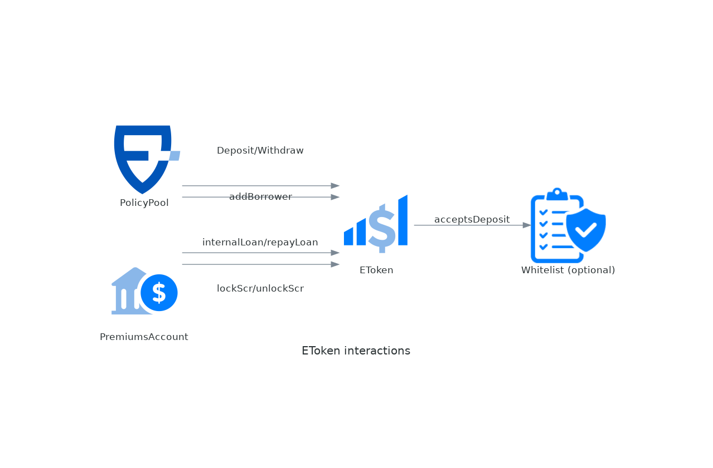

# EToken

This is an ERC20 compatible contract that represents the capital of each liquidity provider in a given pool. The valuation is one-to-one with the underlying stablecoin (it's a rebasing token). The view `scr()` returns the amount of capital that's locked backing up policies. For this capital locked, the pool receives an interest (scrInterestRate() / tokenInterestRate()) that is continuously accrued in the balance of eToken holders. [See more](../protocol/liquidity-pools.md).

An eToken can have an optional [whitelist](ilpwhitelist/overview.md) that controls who can deposit, withdraw or transfer the tokens, and an optional [cooler](cooler/overview.md) that enforces a cooldown period before withdrawals. Both the eToken and the PremiumsAccounts can also have an optional ERC-4626 [yield vault](../protocol/asset-management.md) that invests the funds to generate additional yields.

> **Source:** [EToken.sol](https://github.com/ensuro/ensuro/blob/main/contracts/EToken.sol) · **Full documentation:** [ensuro.readthedocs.io/en/latest/EToken](https://ensuro.readthedocs.io/en/latest/EToken/)

## Interactions



## Parameters

| Field                    | Type                    | Description                                                                                                                  |
| ------------------------ | ----------------------- | ---------------------------------------------------------------------------------------------------------------------------- |
| liquidityRequirement     | uint256 (wad)           | Usually 1.0, used on [withdrawal](../protocol/liquidity-pools.md#withdrawal) to scale the scr locked.                                 |
| minUtilizationRatio      | uint256 (wad)           | Used to prevent [deposits](../protocol/liquidity-pools.md#deposit) to overdilute the returns.                                         |
| maxUtilizationRatio      | uint256 (wad)           | Prevents taking [locking scr](../protocol/liquidity-pools.md#lock) (taking new policies) if utilization ratio exceeds this parameter. |
| internalLoanInterestRate | uint256 (wad)           | Interest rate charged for [internal loans](../protocol/liquidity-pools.md#internal-loan).                                             |
| whitelist                | address (ILPWhitelist)  | Optional contract that, if present, controls who can deposit funds in the eToken. See [ILPWhitelist](ilpwhitelist/overview.md).         |
| cooler                   | address (ICooler)       | Optional contract that, if present, enforces a cooldown period before withdrawals. See [ICooler](cooler/overview.md).                     |
| yieldVault               | address (IERC4626)      | Optional contract that, if present, implements the [asset management](../protocol/asset-management.md) strategy (invests the funds to generate yields).       |

### Packed parameters

To save gas, the numerical parameters are stored in a packed struct that fits in 256bits (a _word_ in the EVM). This is not visible externally, but put's limits on the precision of the parameters. The _wad_ ones, have 4 decimals as precision, so 1.12345 will be truncated to 1.1234.

## Events

### SCRLocked

```solidity
event SCRLocked(uint256 indexed policyId, uint256 interestRate, uint256 value)
```

Event emitted when part of the funds of the eToken are locked as solvency capital.

| Name         | Type    | Description                                            |
| ------------ | ------- | ------------------------------------------------------ |
| policyId     | uint256 | The id of the policy that triggered the lock.          |
| interestRate | uint256 | The annualized interestRate paid for the capital (wad) |
| value        | uint256 | The amount locked                                      |

### SCRUnlocked

```solidity
event SCRUnlocked(uint256 indexed policyId, uint256 interestRate, uint256 value, int256 adjustment)
```

Event emitted when the locked funds are unlocked and no longer used as solvency capital.

| Name         | Type    | Description                                                     |
| ------------ | ------- | --------------------------------------------------------------- |
| policyId     | uint256 | The id of the policy that triggered the unlock.                 |
| interestRate | uint256 | The annualized interestRate that was paid for the capital (wad) |
| value        | uint256 | The amount unlocked                                             |
| adjustment   | int256  | The discrete adjustment applied to the scale.                   |

### InternalLoan

```solidity
event InternalLoan(address indexed borrower, uint256 value, uint256 amountAsked)
```

Event emitted when a [PremiumsAccount](premiumsaccount.md) borrows money from the eToken to cover the payouts.

| Name        | Type    | Description                    |
| ----------- | ------- | ------------------------------ |
| borrower    | address | The address of the _borrower_. |
| value       | uint256 | The amount actually borrowed.  |
| amountAsked | uint256 | The amount asked to borrow.    |

### InternalLoanRepaid

```solidity
event InternalLoanRepaid(address indexed borrower, uint256 value)
```

Event emitted when the premiums account has a surplus (losses less than expected) and repays the eToken.

| Name     | Type    | Description                    |
| -------- | ------- | ------------------------------ |
| borrower | address | The address of the _borrower_. |
| value    | uint256 | The amount to repay.           |

### ETokensRedistributed

```solidity
event ETokensRedistributed(address indexed owner, uint256 distributedProfit)
```

Event emitted when eTokens are burned and their value is redistributed to the rest of the LPs (typically when a cooldown is executed and there were profits during the period).

| Name             | Type    | Description                                          |
| ---------------- | ------- | ---------------------------------------------------- |
| owner            | address | The owner of the burned tokens (the cooler).         |
| distributedProfit | uint256 | The amount distributed between all the LPs.         |

### CoCRefunded

```solidity
event CoCRefunded(uint256 indexed policyId, address indexed receiver, uint256 amount)
```

Event emitted when part of a previously received cost of capital (CoC) is refunded, for example when a policy is cancelled.

| Name     | Type    | Description                          |
| -------- | ------- | ------------------------------------ |
| policyId | uint256 | The id of the policy being refunded. |
| receiver | address | The user that received the refund.   |
| amount   | uint256 | The amount of the refund.            |

## External Methods

### scr

```solidity
function scr() public view returns (uint256)
```

Returns the amount of capital that's locked as solvency capital for active policies.

### totalWithdrawable

```solidity
function totalWithdrawable() public view returns (uint256)
```

Returns the total amount of eTokens that can be withdrawn, i.e. the total supply minus the capital that must be kept to back the active policies (scaled by `liquidityRequirement`).

### scrInterestRate

```solidity
function scrInterestRate() public view returns (uint256)
```

Returns the annualized interest rate (wad) paid for the capital locked as SCR.

### tokenInterestRate

```solidity
function tokenInterestRate() public view returns (uint256)
```

Returns the annualized interest rate accrued to the whole eToken supply, computed from the SCR interest rate and the utilization rate.

### getCurrentScale

```solidity
function getCurrentScale(bool updated) public view returns (uint256)
```

Returns the current scale factor applied to the scaled balances to get the actual balance. If `updated` is true, the accrued interest up to now is included.

### getLoan

```solidity
function getLoan(address borrower) public view returns (uint256)
```

Returns the updated debt (principal + interest) of the `borrower`.

### repayLoan

```solidity
function repayLoan(uint256 amount, address onBehalfOf) external
```

Repays a loan taken with `internalLoan`.

| Name       | Type    | Description                                                                              |
| ---------- | ------- | ---------------------------------------------------------------------------------------- |
| amount     | uint256 | The amount to repay, transferred from `msg.sender` balance.                              |
| onBehalfOf | address | The address of the borrower that took the loan. Usually `onBehalfOf == msg.sender`.      |

### redistribute

```solidity
function redistribute(uint256 amount) external
```

Burns `amount` of the caller's eTokens, redistributing their value to the rest of the LPs. Used by the [Cooler](cooler/cooler.md) to distribute the profits generated during a cooldown period.

### Inter-protocol methods

Some methods are meant to be called by other contracts of the protocol, not by LPs directly:

* `deposit` and `withdraw` are called from the [PolicyPool](policypool.md), which acts as a gateway for LP funds.
* `lockScr`, `unlockScr`, `unlockScrWithRefund` and `internalLoan` are called from the [PremiumsAccount](premiumsaccount.md) to lock/unlock solvency capital and to take internal loans when premiums are exhausted.

See the [full documentation](https://ensuro.readthedocs.io/en/latest/EToken/) for their complete signatures and behavior.
