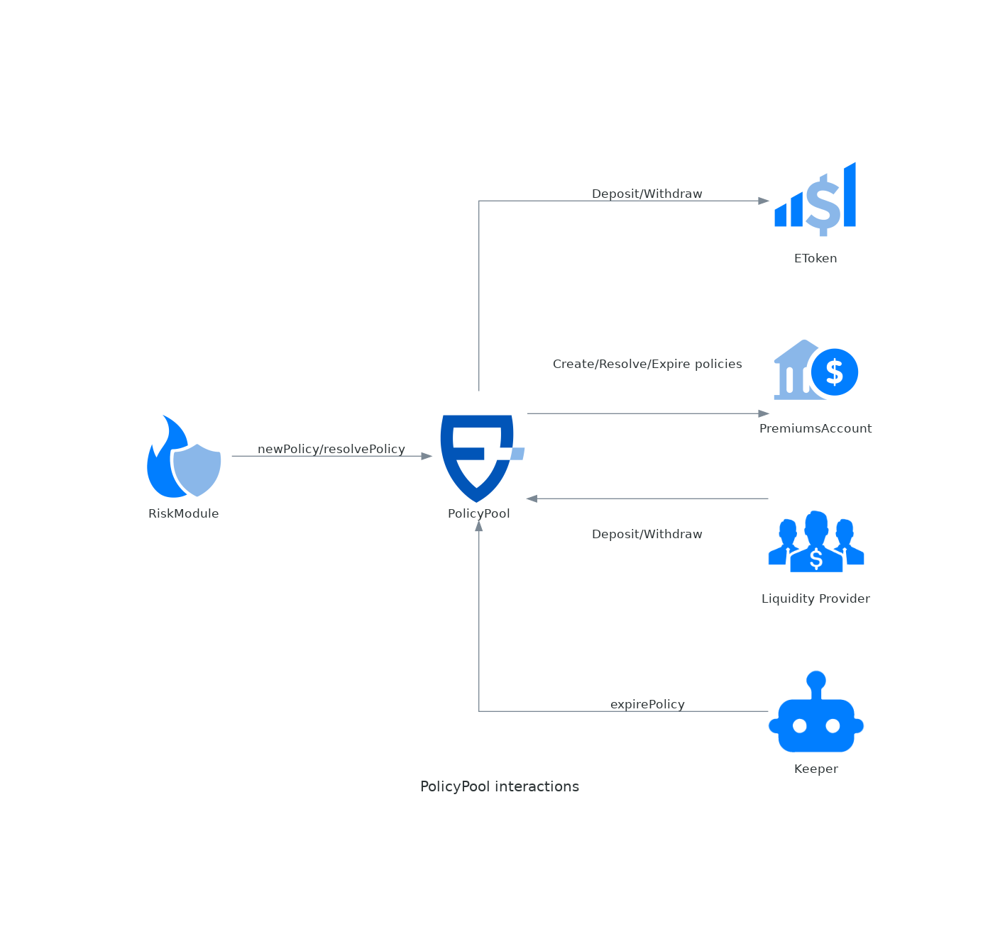

# PolicyPool

The PolicyPool is the main contract that keeps track of active policies and receives the spending allowances. It's a single PolicyPool for each instance of the protocol. One of its attributes is `currency()`, which points to the coin (ERC20) used throughout the protocol. So far we support only USDC as currency.

It has methods for LP to deposit/withdraw, acting as a gateway for the eTokens. The PolicyPool is connected to a set of [eTokens](etoken.md), [premiums accounts](premiumsaccount.md), and [risk modules](riskmodule.md).

The contract also follows the ERC721 standard, minting an NFT for each policy created. The owner of the NFT is the policyholder, and is who will receive the payout in case the policy is triggered. The NFTs are not burned when the policy expires or is triggered: they remain as a permanent record of each policy, while the policy is removed from the active set tracked by the pool.

> **Source:** [PolicyPool.sol](https://github.com/ensuro/ensuro/blob/main/contracts/PolicyPool.sol) · **Full documentation:** [ensuro.readthedocs.io/en/latest/PolicyPool](https://ensuro.readthedocs.io/en/latest/PolicyPool/)

## Interactions



## Parameters

| Field    | Type    | Description                                                                                                                                      |
| -------- | ------- | ------------------------------------------------------------------------------------------------------------------------------------------------ |
| treasury | address | This is the address of the Ensuro Treasury, that receives the protocol fees (see [#ensuro-commission](../protocol/policy.md#ensuro-commission "mention")) |

## Policy database

One of the responsibilities of the PolicyPool contract is to keep track of active policies with all the (immutable) data.

Given the [Policy](../protocol/policy.md) struct has many fields and storage is expensive on-chain, the struct isn't stored as a storage variable of the contracts.

Instead, when the policy is created, only a hash of the struct is stored and an event with all the fields is emitted. Then, for any operation with the Policy (like resolution or expiration), all the policy needs to be sent as a parameter. The PolicyPool contract computes the hash of the parameter and compares it with the stored one.

The mapping from policyId to hash is stored in the `_policies` attribute.

## Events

### NewPolicy

```solidity
event NewPolicy(IRiskModule indexed riskModule, Policy.PolicyData policy)
```

Event emitted every time a new policy is added to the pool. Contains all the data about the policy that is later required for doing operations with the policy like resolution or expiration.

| Name       | Type               | Description                                                                                 |
| ---------- | ------------------ | ------------------------------------------------------------------------------------------- |
| riskModule | IRiskModule        | The risk module that created the policy                                                     |
| policy     | Policy.PolicyData  | The [{Policy-PolicyData}](../protocol/policy.md) struct with all the immutable fields of the policy. |

### PolicyReplaced

```solidity
event PolicyReplaced(IRiskModule indexed riskModule, uint256 indexed oldPolicyId, uint256 indexed newPolicyId)
```

Event emitted every time a policy replaces an old policy. The full data of the new policy is available in the `NewPolicy` event.

| Name        | Type        | Description                             |
| ----------- | ----------- | --------------------------------------- |
| riskModule  | IRiskModule | The risk module that created the policy |
| oldPolicyId | uint256     | The id of the replaced policy.          |
| newPolicyId | uint256     | The id of the new policy.               |

### PolicyCancelled

```solidity
event PolicyCancelled(IRiskModule indexed riskModule, uint256 indexed cancelledPolicyId, uint256 purePremiumRefund, uint256 jrCocRefund, uint256 srCocRefund)
```

Event emitted when a policy is cancelled and part of the premium is refunded. After this, the policy is no longer active.

| Name              | Type        | Description                              |
| ----------------- | ----------- | ---------------------------------------- |
| riskModule        | IRiskModule | The risk module that created the policy  |
| cancelledPolicyId | uint256     | The id of the cancelled policy.          |
| purePremiumRefund | uint256     | The amount of pure premium refunded.     |
| jrCocRefund       | uint256     | The amount of junior CoC refunded.       |
| srCocRefund       | uint256     | The amount of senior CoC refunded.       |

### PolicyResolved

```solidity
event PolicyResolved(IRiskModule indexed riskModule, uint256 indexed policyId, uint256 payout)
```

Event emitted every time a policy is removed from the pool. If the policy expired, the `payout` is 0, otherwise is the amount transferred to the policyholder.

| Name       | Type        | Description                                                                    |
| ---------- | ----------- | ------------------------------------------------------------------------------ |
| riskModule | IRiskModule | The risk module where that created the policy initially.                       |
| policyId   | uint256     | The unique id of the policy                                                    |
| payout     | uint256     | The payout that has been paid to the policy holder. 0 when the policy expired. |

### Deposit

```solidity
event Deposit(IEToken indexed eToken, address indexed sender, address indexed owner, uint256 amount)
```

Event emitted for every deposit into an eToken.

| Name   | Type    | Description                                                       |
| ------ | ------- | ----------------------------------------------------------------- |
| eToken | IEToken | The eToken receiving the funds                                    |
| sender | address | The sender of the funds                                           |
| owner  | address | The user that will receive the minted eTokens                     |
| amount | uint256 | Amount in `currency()` paid for the eTokens                       |

### Withdraw

```solidity
event Withdraw(IEToken indexed eToken, address indexed sender, address indexed receiver, address owner, uint256 amount)
```

Event emitted for every withdrawal from an eToken.

| Name     | Type    | Description                                                          |
| -------- | ------- | -------------------------------------------------------------------- |
| eToken   | IEToken | The eToken where the withdrawal is done                              |
| sender   | address | The user calling the withdraw method                                 |
| receiver | address | The user that receives the resulting funds (`currency()`)            |
| owner    | address | The owner of the burned eTokens                                      |
| amount   | uint256 | Amount in `currency()` received by `receiver`                        |

## External Methods

### expirePolicy

```solidity
function expirePolicy(Policy.PolicyData calldata policy) external
```

Resolves a policy with a payout of 0, unlocking the solvency. Can be called by anyone, but only after `Policy.expiration`.

Requirements:

* `policy`: must be a Policy previously created with `newPolicy` (checked with `policy.hash()`) and not resolved before
* Policy expired: `Policy.expiration` <= block.timestamp

Events:

* {PolicyPool-PolicyResolved}: with payout == 0

| Name   | Type               | Description                                  |
| ------ | ------------------ | -------------------------------------------- |
| policy | Policy.PolicyData  | A policy previously created with `newPolicy` |

### Policy creation and resolution

The methods that create, replace, cancel and resolve policies — `newPolicy`, `newPoliciesBatch`, `replacePolicy`, `cancelPolicy` and `resolvePolicy` — are internal to the protocol and are meant to be called by active [RiskModules](riskmodule.md), not by end users or integrations. See the [full documentation](https://ensuro.readthedocs.io/en/latest/PolicyPool/) for their complete signatures and behavior.
