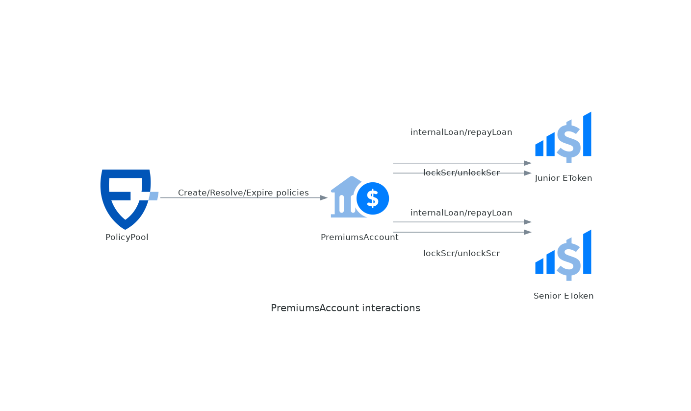

# PremiumsAccount

The risk modules are grouped in _premiums accounts_ that keep track of the pure premiums (active and earned) their policies. The responsibility of these contracts is to keep track of the premiums and release the payouts. When premiums are exhausted (losses more than expected), they borrow money from the _eTokens_ to cover the payouts. This money will be repaid when/if later the premiums account has a surplus (losses less than expected). [See more](../protocol/premiums-accounts.md).

> **Source:** [PremiumsAccount.sol](https://github.com/ensuro/ensuro/blob/main/contracts/PremiumsAccount.sol) · **Full documentation:** [ensuro.readthedocs.io/en/latest/PremiumsAccount](https://ensuro.readthedocs.io/en/latest/PremiumsAccount/)

## Interactions



## Parameters

| Field        | Type                    | Description                                                                                                                          |
| ------------ | ----------------------- | ------------------------------------------------------------------------------------------------------------------------------------ |
| deficitRatio | uint256 (wad)           | Usually 1.0 (max value). Controls the proportion of the active pure premiums that can be used to cover losses of finalized policies. |
| jrLoanLimit  | uint256 (amount)        | Maximum amount that can be borrowed from the Junior eToken (no limit if 0).                                                           |
| srLoanLimit  | uint256 (amount)        | Maximum amount that can be borrowed from the Senior eToken (no limit if 0).                                                           |
| yieldVault   | address (IERC4626)      | Optional contract that, if present, implements the [asset management](../protocol/asset-management.md) strategy (invests the funds to generate yields).                  |

### Packed parameters

To save gas, the parameters are stored in a packed struct that fits in 256bits (a _word_ in the EVM). This is not visible externally, but put's limits on the precision of the parameters. The _wad_ ones, have 4 decimals as precision, so 1.12345 will be truncated to 1.1234.

## Events

### WonPremiumsInOut

```solidity
event WonPremiumsInOut(bool moneyIn, uint256 value)
```

Premiums can come in (for "free", without liability) with receiveGrant. And can come out (withdrawn) with withdrawWonPremiums.

| Name    | Type    | Description                                |
| ------- | ------- | ------------------------------------------ |
| moneyIn | bool    | Indicates if money came in or out (false). |
| value   | uint256 | The amount of money received or given      |

## External Methods

### receiveGrant

```solidity
function receiveGrant(uint256 amount) external
```

Endpoint to receive "free money" and inject that money into the premium pool.

Can be used for example if the PolicyPool subscribes an excess loss policy with other company.

Requirements:

* The sender needs to approve the spending of `currency()` by this contract.

Events:

* Emits {WonPremiumsInOut} with moneyIn = true

| Name   | Type    | Description                   |
| ------ | ------- | ----------------------------- |
| amount | uint256 | The amount to be transferred. |

### withdrawWonPremiums

```solidity
function withdrawWonPremiums(uint256 amount, address destination) external returns (uint256)
```

Withdraws excess premiums (surplus) to the destination.

This might be needed in some cases for example if we are deprecating the protocol or the excess premiums are needed to compensate something.

Requirements:

* `_surplus > 0`

Events:

* Emits {WonPremiumsInOut} with moneyIn = false

| Name        | Type    | Description                                          |
| ----------- | ------- | ---------------------------------------------------- |
| amount      | uint256 | The amount to withdraw. `type(uint256).max` withdraws as much as possible. |
| destination | address | The address that will receive the transferred funds. |

| Name | Type    | Description                          |
| ---- | ------- | ------------------------------------ |
| \[0] | uint256 | Returns the actual amount withdrawn. |

### repayLoans

```solidity
function repayLoans() external returns (uint256 available)
```

Repays the loan(s) taken from the eTokens if funds are available (i.e. the premiums account has a surplus).

| Name      | Type    | Description                                  |
| --------- | ------- | -------------------------------------------- |
| available | uint256 | The funds still available after repayment.   |

### purePremiums

```solidity
function purePremiums() external view returns (uint256)
```

The total amount of premiums held by this PremiumsAccount (active pure premiums plus the surplus, if any).

### activePurePremiums

```solidity
function activePurePremiums() external view returns (uint256)
```

Returns the total amount of pure premiums that were collected by the active policies of the risk modules linked to this PremiumsAccount.

### wonPurePremiums

```solidity
function wonPurePremiums() external view returns (uint256)
```

Returns the surplus between pure premiums collected and payouts of finalized policies. Returns 0 if no surplus or deficit.

### borrowedActivePP

```solidity
function borrowedActivePP() external view returns (uint256)
```

Returns the amount of active pure premiums that was used to cover payouts of finalized policies (in excess of collected pure premiums). This is limited by `_maxDeficit()`.

### surplus

```solidity
function surplus() external view returns (int256)
```

Returns the surplus between pure premiums collected and payouts of finalized policies. Losses where more than premiums collected, returns a negative number that indicates the amount of the active pure premiums that was used to cover finalized premiums.

### Inter-protocol methods

The methods that keep the PremiumsAccount in sync with the lifecycle of the policies — `policyCreated`, `policyReplaced`, `policyCancelled`, `policyResolvedWithPayout` and `policyExpired` — are called from the [PolicyPool](policypool.md), not by end users or integrations. See the [full documentation](https://ensuro.readthedocs.io/en/latest/PremiumsAccount/) for their complete signatures and behavior.
